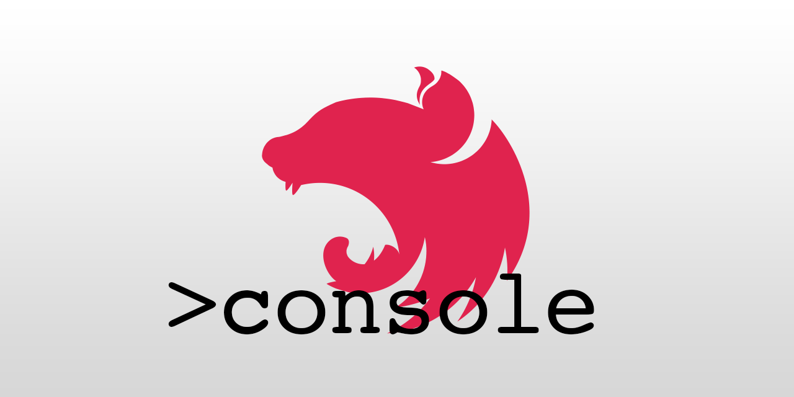

<div align="center">

[][npm]
[](https://github.com/Pop-Code/nestjs-console/actions/workflows/test.yml?query=branch%3Amaster+event%3Apush)
[][codecov]
[][npmchart]


</div>

[nestjs-console][npm] is a module that provide a cli. A ready to use service class for your modules that exposes methods to register commands and sub commands using the [npm package commander][commander]

## Why

The nestjs framework is missing a cli to access the application context.  
Common use case : Headless application, cron task, export data, etc...
[nestjs-console][npm] provide a way to bind cli command and subcommands to providers's methods.

## How it works

The console service works as a standalone process, like the classic entry point, and will initialize a NestApplicationContext (headless) instead a NestApplication.
The console service will be accessible inside the container.

1. Bootstrap (entry point e.g console.ts) is invoked by cli.
2. Create a headless nest app, any module inside the app can create command and subcommands using nestjs-console with [commander][commander]
3. nestjs-console invoke commander
4. commander will do the rest.

## Features

- Commands and sub commands (git style) declared with decorators or registered with a service, on any provider
- All the commander features: arguments with descriptions, choices and defaults, options with choices, environment variables, conflicts..., aliases, hidden and default commands, help groups and texts
- Nest parameter decorators `@Arg()`, `@Opt()` and `@Cmd()`, with pipes (`ParseIntPipe`, `ValidationPipe` on a DTO...)
- Guards, interceptors and exception filters on commands
- `run()` executes the command, prints the errors, sets the exit code and closes the application
- `runCommand()` to test the commands
- Shell completion for bash, zsh and fish

## Example

```ts
// console.ts
import { BootstrapConsole } from 'nestjs-console';
import { AppModule } from './app.module';

new BootstrapConsole({ module: AppModule, useDecorators: true, cli: { name: 'my-cli' } }).run();
```

```ts
// users.cli.ts, a provider of a module that imports ConsoleModule
import { ParseIntPipe } from '@nestjs/common';
import { Arg, Command, Console, Opt } from 'nestjs-console';

@Console({ command: 'users', description: 'Manage the users' })
export class UsersCli {
    constructor(private readonly users: UsersService) {}

    @Command({
        command: 'show <id>',
        description: 'Show a user',
        options: [{ flags: '-f, --format <format>', choices: ['json', 'table'], defaultValue: 'table' }]
    })
    async show(@Arg('id', ParseIntPipe) id: number, @Opt('format') format: 'json' | 'table') {
        const user = await this.users.find(id);
        console.log(format === 'json' ? JSON.stringify(user) : user);
    }
}
```

```bash
node dist/console.js users show 42 --format json
```

# Documentation

- [Wiki](https://github.com/Pop-Code/nestjs-console/wiki)
- [API](https://pop-code.github.io/nestjs-console)
- [Changelog](https://github.com/Pop-Code/nestjs-console/blob/master/CHANGELOG.md)

[npm]: https://www.npmjs.com/package/nestjs-console
[npmchart]: https://npmcharts.com/compare/nestjs-console?minimal=true
[ci]: https://circleci.com/gh/Pop-Code/nestjs-console
[codecov]: https://codecov.io/gh/Pop-Code/nestjs-console
[commander]: https://www.npmjs.com/package/commander
[changelog]: https://github.com/Pop-Code/nestjs-console/blob/master/CHANGELOG.md
